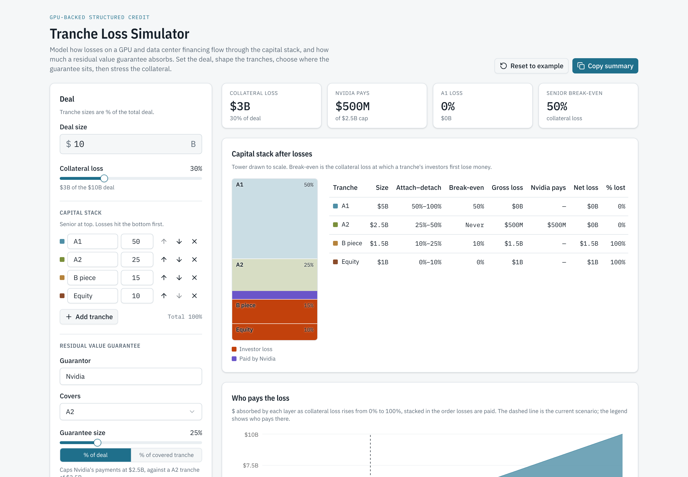

# Tranche Loss Simulator

[](https://github.com/MaciSekander/tranche-loss-simulator/actions/workflows/ci.yml)


[](LICENSE)

**Live demo: https://tranche-loss-simulator.vercel.app**

An interactive tool for GPU-backed structured credit. Set a deal size, shape the capital stack, choose which tranche a residual value guarantee (RVG) covers, then stress the collateral and see who absorbs the loss.

Built with Next.js, Tailwind CSS and shadcn/ui.



## What it shows

- **Capital stack after losses:** a to-scale tower and a waterfall table with each tranche's attachment and detachment points, break-even loss, gross loss, guarantee payments, net loss and status.
- **Who pays the loss:** a stacked area chart of the dollars absorbed by each layer, including the guarantor, as collateral loss rises from 0% to 100%.
- **Headline figures:** collateral loss, guarantor payments against the cap, senior loss and senior break-even.
- **Model notes:** what the current scenario assumes, how the waterfall works, and what the model leaves out.

You can rename, add, remove and reorder tranches (up to six), name the guarantor, and size the guarantee as a percentage of the whole deal or of the covered tranche. **Copy summary** puts a plain-text table of the scenario on the clipboard. The browser remembers your last scenario.

## How the model works

1. Collateral loss = loss % × deal size.
2. Losses fill tranches from the most junior upward. Each tranche absorbs losses between its attachment and detachment points.
3. If a guarantee covers a tranche, losses landing on that tranche are paid by the guarantor first, up to the cap. The guarantor pays nothing for losses below or above that tranche.
4. **Break-even** is the collateral loss at which a tranche's investors first lose money. For the covered tranche it moves up by the size of the guarantee.

The model is a strict sequential waterfall at a single point in time: no pro rata sharing, coverage tests, recoveries, coupons or amortization.

## Run it locally

Requires Node.js 22.6 or later.

```bash
npm install
npm run dev     # http://localhost:3000
npm test        # waterfall unit tests
npm run build   # production build
```

## Project layout

```
lib/waterfall.ts            The model: waterfall, guarantee cap, break-even, who-pays sweep
lib/waterfall.test.ts       Unit tests (node:test)
lib/format.ts               Money and percent formatting, plain-text summary
components/simulator/       Inputs panel, KPIs, capital stack, who-pays chart, model notes
components/ui/              shadcn/ui components
app/                        Next.js App Router page, layout, theme and self-hosted IBM Plex fonts
```

The model in `lib/waterfall.ts` has no React dependencies, so it can be reused or extended on its own.

## Next steps

- **Pricing:** add a spread per tranche and show loss-adjusted yield.
- **GPU residual value:** drive collateral loss from a GPU rental price path (H100, B200, GB300) instead of a direct input.
- **Timing:** model cash flows and amortization over the life of the deal.
- **Probability of loss:** Monte Carlo over loss scenarios for expected loss and probability of impairment by tranche.

## License

[MIT](LICENSE) © Maci Sekander

## Credits

IBM Plex fonts are licensed under the SIL Open Font License; see `app/fonts/OFL.txt`.
